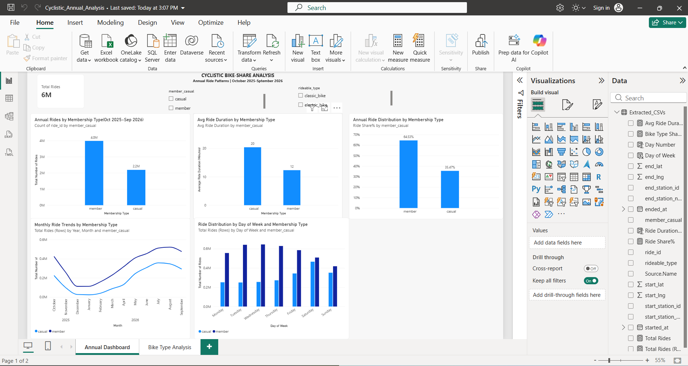
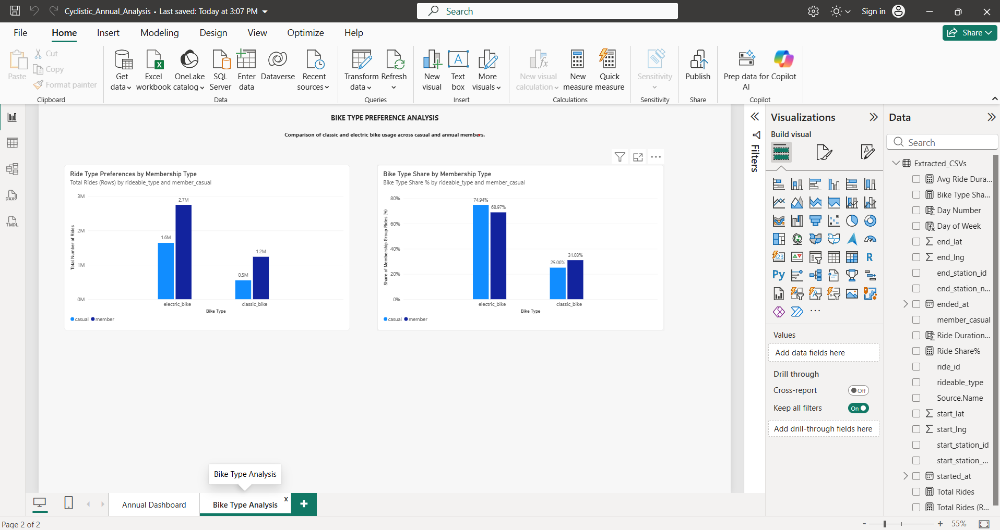

# Data Analytics Portfolio

Hi! I'm Sheetal Patri, a Computer Engineering graduate interested in Data Analytics.

This repository showcases my practical projects, analytical skills, and ability to turn raw data into meaningful business insights.

## Projects

### 1. Cyclistic Bike-Share Analysis

**Project Overview**

Analyzed 12 months of bike-share trip data (October 2025 – September 2026) to identify differences in usage patterns between casual riders and annual members.

**Business Objective**

Understand how casual riders and annual members use the bike-sharing service differently and identify opportunities to convert casual riders into annual members.

**Tools & Technologies**
- Microsoft Excel
- Power BI
- Power Query

**Key Findings**
- Annual members accounted for 64.52% of total rides.
- Casual riders accounted for 35.48% of total rides.
- Casual riders had a higher average ride duration than members.
- Saturday recorded the highest casual rider activity.
- Wednesday recorded the highest member activity.
- Electric bikes accounted for the majority of rides.

**Business Recommendations**
- Introduce targeted membership promotions for casual riders.
- Focus marketing campaigns on weekends.
- Highlight the benefits of annual memberships to frequent casual riders.

**Dashboard Preview**

**Project Files**

- [Case Study Documentation](Cyclistic-Bike-Share-Analysis/Documentation/)
- [Dataset Information](Cyclistic-Bike-Share-Analysis/Data/)
- [Analysis Files](Cyclistic-Bike-Share-Analysis/Analysis/)

## Contact

- LinkedIn: [Sheetal Patri](https://www.linkedin.com/in/sheetalpatri26/)
- Email: patrisheetal26@gmail.com